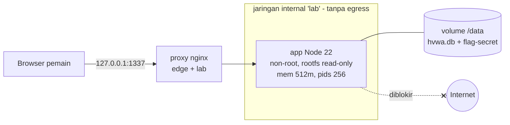
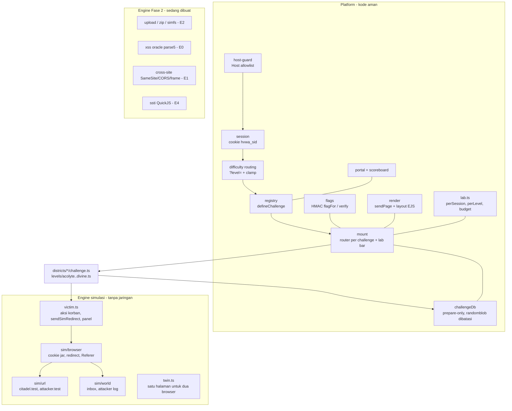
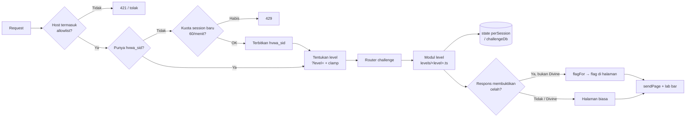
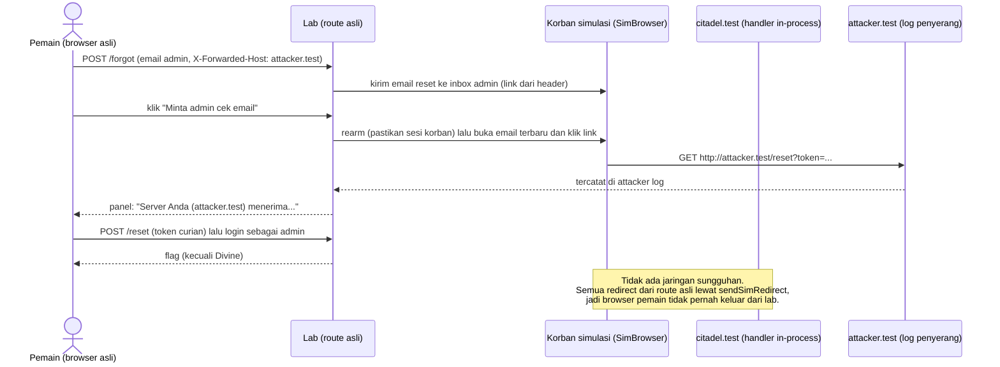
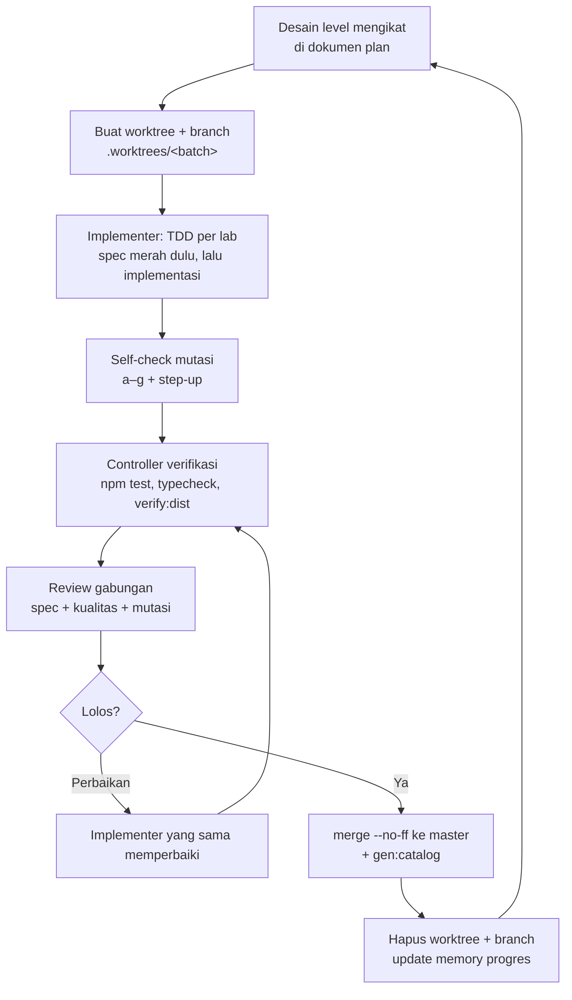
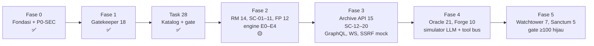

# HVWA: Context, PRD & Flowchart

> Ringkasan konteks proyek **HVWA (Holy Vulnerable Web App)**: apa yang dibangun, kenapa, bagaimana arsitekturnya, alur pemakaian, dan posisi pengerjaannya sekarang.
> Kondisi per **16 November 2026**, `master` di commit `6a13668`.
> Rinciannya ada di dokumen sumber (lihat §10). Kalau ada yang bertentangan, dokumen sumber yang berlaku.

---

## 1. Ringkasan produk

HVWA adalah aplikasi web yang **sengaja dibuat rentan** untuk belajar keamanan web secara langsung. Ini penerus modern DVWA.

- **122 challenge** dalam **9 district** bertema, mencakup web klasik, API modern, AI/LLM/agentic, supply chain, sampai blue team.
- Setiap challenge punya **4 level kesulitan**:

  | Level | Setara DVWA | Arti |
  |---|---|---|
  | **Acolyte** | Low | Tanpa proteksi |
  | **Templar** | Medium | Filter naif / blacklist |
  | **Inquisitor** | High | Proteksi nyata tapi masih ada celah |
  | **Divine** | Impossible | Implementasi aman, selaras ASVS. Ini yang dijadikan acuan "lihat perbaikannya". |

- Setiap level yang bisa dieksploitasi menghasilkan **flag** saat berhasil. Divine tidak pernah mengeluarkan flag.
- **View Source + Diff**: pemain bisa membandingkan kode level yang rentan dengan Divine.
- **Dwibahasa ID/EN**, defaultnya Bahasa Indonesia.
- **Offline dan self-hosted**. Hanya bisa diakses dari loopback (`127.0.0.1`).

### Tujuan
1. Menjadi lab latihan keamanan web yang modern, lengkap (100+ challenge), dan gratis.
2. Melayani pemula dan praktisi sekaligus lewat 4 level dalam satu challenge.
3. Setiap solusi dapat dinilai otomatis dan deterministik, tanpa koneksi internet maupun layanan pihak ketiga.
4. Mengisi ceruk pembelajaran keamanan berbahasa Indonesia.

### Target pengguna
- Pelajar dan mahasiswa yang baru belajar keamanan web.
- Praktisi (pentester, developer, blue team) yang ingin melatih teknik modern.
- Pengajar dan kelas. Fitur instruktur direncanakan sebagai pekerjaan lanjutan.

### Di luar cakupan (non-goals) untuk rencana ini
- Campaign/Pilgrimage mode (cerita berantai antar district), Patch Mode, WAF toggle, export CTFd, dashboard instruktur, dan layanan poliglot. Semua ini dicatat sebagai rencana terpisah di kemudian hari.
- Deploy ke jaringan publik. Ini **dilarang**.

---

## 2. Keputusan utama

| # | Keputusan | Pilihan |
|---|---|---|
| 1 | Target user | Pemula + praktisi (4 level) |
| 2 | Stack | Satu bahasa: Node 22 + TypeScript, Express 5, EJS, `node:sqlite`, Zod, htmx (vendored); test dengan Vitest + Supertest |
| 3 | Backend AI | Simulator LLM deterministik (default); Ollama dan kunci API milik pengguna opsional |
| 4 | Presentasi | Mode modul terisolasi dulu, Campaign belakangan |
| 5 | Lisensi | MIT, ditulis dari nol (tidak menyalin kode DVWA yang berlisensi GPL-3.0) |
| 6 | Bahasa UI | ID/EN, default ID |
| 7 | Oracle XSS (Fase 2) | `parse5@8.0.1`. Bukti XSS dianalisis secara statis; JS pemain **tidak pernah** dijalankan di server |
| 8 | Sandbox SSTI (Fase 2) | QuickJS-WASM di `worker_thread` (+ `nunjucks`); tanpa container baru |
| 9 | Header lab (Fase 2) | CSP/XFO/CORS dipasang **per route** lewat `core/http.ts`; tidak ada perubahan header global |
| 10 | Pratinjau XSS | `<iframe sandbox="allow-scripts">` (origin null), supaya pemain bisa melihat payload jalan dengan aman |
| 11 | "Eksekusi" (upload/RCE) | **Hanya simulasi**: interpreter penanda `<?hvwa CANARY ?>` di atas filesystem simulasi; tidak ada kode yang benar-benar dijalankan |

---

## 3. Kebutuhan

### 3.1 Fungsional
- **FR-1 Portal**: peta district, daftar challenge, scoreboard.
- **FR-2 Halaman challenge**: memilih level, deskripsi, 3 tingkat hint dwibahasa (pertanyaan pemandu, tanpa payload literal), View Source per level, Diff terhadap Divine, form kirim flag.
- **FR-3 Flag**: flag unik per instance (HMAC), diterbitkan hanya lewat `flagFor` saat respons membuktikan celahnya. `/api/submit` mencatat solve pada level yang benar.
- **FR-4 Scoreboard**: progres per sesi pemain.
- **FR-5 State per pemain**: semua state lab yang bisa berubah bersifat per sesi dan per level (`perSession`), sehingga eksploit satu pemain tidak mengubah lab pemain lain.
- **FR-6 Korban simulasi**: untuk lab yang butuh korban (reset password, OAuth, CSRF, XSS tersimpan, dan sejenisnya), tersedia "admin" simulasi yang mengklik link atau membuka email, inbox, dan log server penyerang (`attacker.test`).
- **FR-7 Restart lab**: hanya untuk lab yang bisa macet, dan tidak pernah mengisi ulang kuota atau limiter.
- **FR-8 Katalog**: `src/catalog.ts` (122 baris) ditambah `npm run gen:catalog`, yang menghasilkan `docs/CATALOG.md`. Release gate `npm run gate:catalog` mensyaratkan minimal 100 challenge terdaftar.

### 3.2 Non-fungsional
- **NFR-1 Keamanan host**: bind ke `127.0.0.1`; container non-root dengan rootfs read-only, `cap_drop: ALL`, dan `no-new-privileges`; jaringan internal tanpa egress; proxy nginx hanya di loopback; Host allowlist sebagai pertahanan DNS rebinding.
- **NFR-2 Isolasi kerentanan**: kerentanan hanya ada di permukaan simulasi milik challenge itu sendiri (DB, filesystem simulasi, atau sandbox challenge tersebut), tidak pernah di kode platform. Halaman hanya dirender lewat `sendPage()`, dan input penyerang masuk ke DB hanya lewat `challengeDb.prepare()`.
- **NFR-3 Deterministik**: tanpa jaringan sungguhan dan dengan jam yang bisa diinjeksi, sehingga test cepat dan stabil.
- **NFR-4 Memori**: container dibatasi `mem_limit: 512m`. Semua map dibatasi. Semua state simulasi berbagi satu anggaran se-proses: 150 world, yang akan diganti menjadi anggaran berbobot byte 96 MiB. Setiap field yang disimpan adalah salinan, bukan potongan string atau Buffer milik request.
- **NFR-5 Kualitas**: TDD. Matriks eksploit a–g per lab mencakup step-up (eksploit level L gagal di semua level di atasnya). Ada uji mutasi, dan review spec plus kualitas untuk setiap batch.
- **NFR-6 Offline**: setelah build pertama, HVWA berjalan tanpa internet.

---

## 4. Katalog & district

| District | Tema | Challenge | Fase | Status |
|---|---|---|---|---|
| A. **Gatekeeper** | Auth & Access Control | 18 | 1 | ✅ Selesai (18/18) |
| B. **Relic Market** | E-commerce & business logic | 14 | 2 | 🟡 3 lab sudah dibuat, belum di-merge (dijeda) |
| C. **Scriptorium** | File, parsing, SSRF | 20 | 2 (SC-01–11) / 3 (SC-12–20) | ⏳ Desain selesai, engine sedang dibuat |
| D. **Forum of Pilgrims** | Sosial & injeksi | 12 | 2 | ⏳ Desain selesai |
| E. **Archive API** | GraphQL, REST, WebSocket | 15 | 3 | ⬜ Belum |
| F. **Oracle** | AI / LLM / Agentic | 21 | 4 | ⬜ Belum |
| G. **Forge** | Supply chain & DevSecOps | 10 | 4 | ⬜ Belum |
| H. **Watchtower** | Blue team, logging | 7 | 5 | ⬜ Belum |
| I. **Sanctum** | Riset lanjutan (smuggling, cache) | 5 | 5 | ⬜ Belum |
| | **Total** | **122** | | **18/122 (≈15%)** |

Daftar lengkap per challenge ada di [docs/CATALOG.md](docs/CATALOG.md).

---

## 5. Arsitektur

### 5.1 Topologi deploy (Docker)



### 5.2 Komponen aplikasi



### 5.3 Pola folder challenge

```
src/districts/<district>/<nn-slug>/
  challenge.ts        # metadata, hint, mount() → dispatch ke levels[req.level]
  model.ts            # state, kontrak level, seam untuk test
  levels/acolyte.ts   # satu file per level, ditampilkan apa adanya oleh View Source
  levels/templar.ts
  levels/inquisitor.ts
  levels/divine.ts    # referensi aman (target Diff)
  views/*.ejs         # hanya dirender lewat sendPage()
  <id>.spec.ts        # bukti solve + bukti Divine bertahan
```

---

## 6. Flowchart

### 6.1 Alur pemain

```mermaid
flowchart TD
    A[Buka http://127.0.0.1:1337] --> B[Portal: peta district]
    B --> C[Pilih challenge]
    C --> D[Pilih level<br/>Acolyte / Templar / Inquisitor / Divine]
    D --> E[Baca tujuan + hint 1..3]
    E --> F[Eksplorasi lab<br/>browser / curl / Burp]
    F --> G{Eksploit berhasil?}
    G -- Belum --> H[Lihat hint berikutnya<br/>atau View Source level]
    H --> F
    G -- Ya --> I[Flag tampil<br/>HVWA&#123;...&#125;]
    I --> J[Kirim flag /api/submit]
    J --> K{Valid untuk level ini?}
    K -- Ya --> L[Solve tercatat<br/>scoreboard naik]
    K -- Tidak --> F
    L --> M[Buka Diff: rentan vs Divine]
    M --> N{Naik level?}
    N -- Ya --> D
    N -- Tidak --> C
```



### 6.2 Alur request di server



### 6.3 Alur lab korban simulasi (contoh: GK-09 reset link host poisoning)



### 6.4 Alur pengembangan per batch (subagent-driven)



### 6.5 Roadmap fase



---

## 7. Status pengerjaan (16 Nov 2026)

### ✅ Selesai di `master` (`6a13668`, 1799 test lulus)
- Fase 0: engine inti (registry, flag, session, difficulty, hint, i18n, render, portal, scoreboard, halaman challenge + View Source/Diff), plus P0-SEC (Docker yang di-hardening).
- Engine korban simulasi D0 beserta hardening-nya: `core/sim/*`, `core/victim.ts`, dan anggaran memori se-proses.
- **Gatekeeper lengkap, 18 challenge** (GK-01 sampai GK-18).
- Task 28: katalog 122 baris, `gen:catalog`, dan `gate:catalog`.
- Perbaikan dua test flaky: GK-02 dan flood di `mount.spec`.
- Desain mengikat Fase 2: Relic Market, Scriptorium SC-01–11, Forum FP-01–12, engine E0–E4, berikut keputusan owner dan amandemennya.
- Shared-template: `core/twin.ts`, helper lintas district (`districts/_shared/`), testkit lab korban, dan batas `randomblob`/`zeroblob` di semua DB challenge.

### 🟡 Sedang dijeda (worktree masih ada; pekerjaan tersimpan)
| Worktree | Isi | Sisa |
|---|---|---|
| `rm-a` | Shell toko + RM-05, RM-09, RM-14 (sudah di-commit, `master` sudah di-merge) | Gate akhir, review, merge. Setelah ini progres jadi 21/122. |
| `engine-e2` | Upload/zip/simfs + 6 dari 12 perbaikan review | `placeholderImage`, anggaran berbobot byte, `uploadGate`, RECIPES, test mutasi, merge `master` |
| `engine-e0` | parse5 sudah dipin; kode oracle **belum di-commit** | Implementasi oracle + pratinjau + lab fixture, review |

### ⬜ Belum dikerjakan
- **Fase 2**: Relic Market batch B (RM-01–04), C (RM-06/07/08/10), dan D (RM-11/12/13); engine E1 (SameSite/CORS/frame), E3 (twin JS client), dan E4 (sandbox SSTI); 11 lab Scriptorium; 12 lab Forum.
- **Fase 3**: Archive API AR-01–15 (GraphQL, WebSocket) dan SC-12–20 (XXE, SSRF + mock IMDS, deserialisasi).
- **Fase 4**: simulator LLM deterministik + tool bus, Oracle OR-01–21 (termasuk stub MCP), dan Forge FO-01–10 (mock registry paket).
- **Fase 5**: Watchtower WT-01–07 (mini-SIEM; WT-02/03 berupa puzzle tanpa level, sehingga registry perlu menanganinya) dan Sanctum SA-01–05 (nginx front untuk request smuggling dan cache layer).
- **Release gate**: `npm run gate:catalog` hijau (minimal 100 challenge).

---

## 8. Risiko & catatan terbuka
- **Flake ketiga** (`mount.spec`, test clamp templar) belum diketahui penyebabnya. Dugaan terkuat: tabrakan port dengan proses lain.
- **Celah self-DoS SQL yang diterima**: `printf` width, `replace()`, dan CTE rekursif masih bisa memakan memori besar. Ini diterima karena lab hanya loopback dengan satu pemain.
- **`NODE_OPTIONS=--max-old-space-size=256`** untuk container ditunda sampai memori QuickJS (E4) diukur di container sungguhan.
- **Batas pemakaian akun** (5 jam) dan crash Extension Host VS Code bisa menghentikan agent. Progres dicatat di memory agar bisa dilanjutkan, dan sesi panjang lebih aman dijalankan lewat `claude` di Windows Terminal.

---

## 9. Konvensi pengembangan
- Jalankan test dari path dengan huruf drive **kapital** (`C:\...`). Dengan `c:\` huruf kecil, `vi.mock` gagal dan test tampak merah padahal tidak.
- Gate setiap commit: `npm test` + `npm run typecheck` (dilihat dari exit code), dan `npm run verify:dist` sebelum merge.
- Setiap batch dikerjakan di worktree sendiri (`.worktrees/<branch>`), di-merge dengan `--no-ff`, lalu worktree dan branch-nya dihapus.
- Setiap challenge baru ditambahkan ke katalog lalu `npm run gen:catalog` dijalankan (checklist RECIPES §7).

---

## 10. Peta dokumen sumber
| Dokumen | Isi |
|---|---|
| [docs/superpowers/plans/2026-11-15-hvwa.md](docs/superpowers/plans/2026-11-15-hvwa.md) | Rencana induk: keputusan, katalog 122, kontrak engine, task Fase 0–1, desain Batch A–D Gatekeeper, ringkasan Fase 2–5 |
| [docs/superpowers/plans/2026-11-16-phase2-relic-market.md](docs/superpowers/plans/2026-11-16-phase2-relic-market.md) | Desain mengikat RM-01–14 + keputusan controller |
| [docs/superpowers/plans/2026-11-16-phase2-scriptorium-forum.md](docs/superpowers/plans/2026-11-16-phase2-scriptorium-forum.md) | Desain engine E0–E4 + SC-01–11 + FP-01–12, keputusan owner, amandemen |
| [docs/RECIPES.md](docs/RECIPES.md) | Panduan menulis challenge: pola folder, helper, aturan platform, test, lab korban, upload |
| [docs/CATALOG.md](docs/CATALOG.md) | Katalog yang dihasilkan otomatis, dengan status tiap challenge |
| [docs/SECURITY.md](docs/SECURITY.md) | Threat model lab itu sendiri |
| [docs/RESEARCH.md](docs/RESEARCH.md) | Riset latar: DVWA, OWASP 2025, API Top 10, LLM/Agentic |
| [README.md](README.md) | Quick start Docker + pengembangan lokal |
